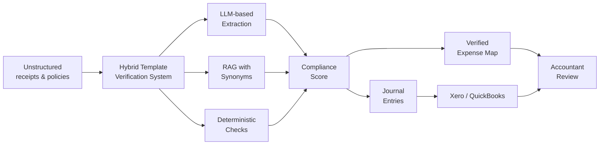
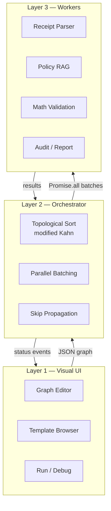
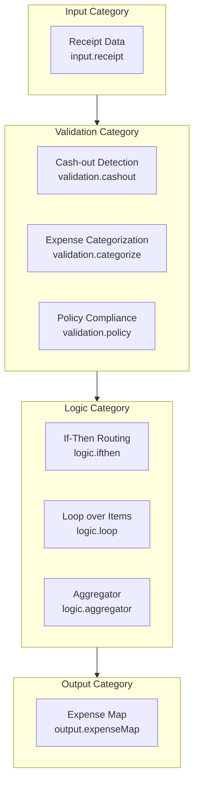
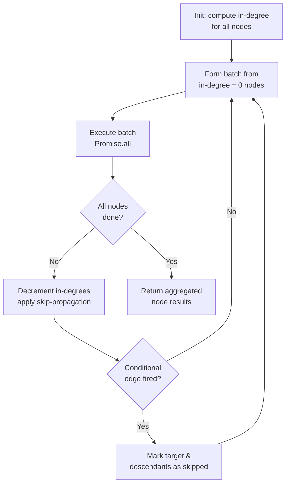
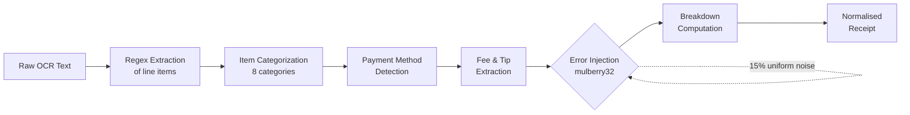
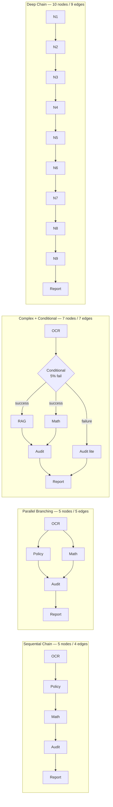
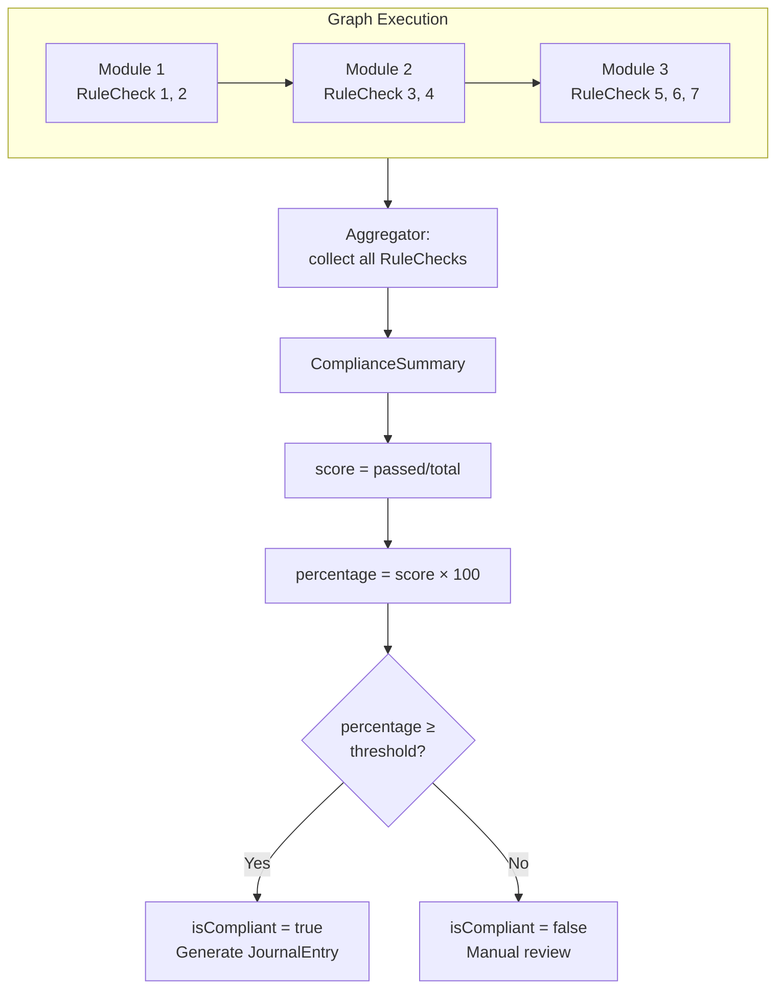
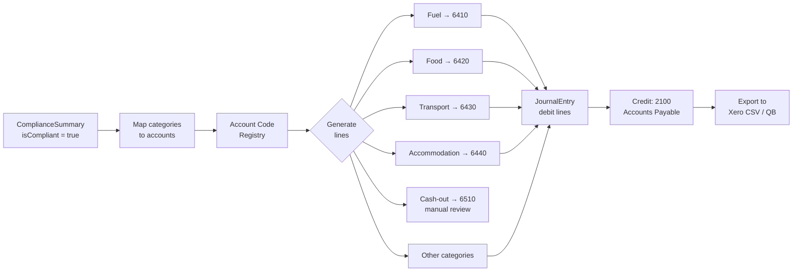

# Automating the Construction of Financial-Document Verification Systems from Templates: A Hybrid Approach with RAG Augmentation and a Graph Orchestrator

**R&D Department**

*November 2025*

---

## Graphical Abstract



**Figure GA.** Paper overview: unstructured inputs (receipts and corporate policies) are processed by the hybrid template verification system that combines three pillars (LLM extraction, RAG, deterministic checks), yielding a compliance score, journal entries exportable to Xero/QuickBooks, and a verified expense map for accountant review.

---

## Abstract

This study presents the design and experimental evaluation of a hybrid approach to constructing financial-document verification systems from visually composable templates, combining information extraction by large language models (LLMs), retrieval-augmented generation (RAG), and deterministic verification algorithms orchestrated through an executable directed acyclic graph (DAG). The relevance of the work stems from the exponential growth in the volume of corporate financial documentation and the limitations of traditional rule-based systems, which cannot handle semantic nuances such as masked cash-out, loyalty-point redemptions, and acquirer card fees. The paper proposes a modular architecture comprising eight types of template modules, grouped into four categories: input, validation, logic, and output. Module orchestration is performed through a visually composable rule graph, compiled into an executable state graph and topologically sorted by a modified Kahn's algorithm. Three experiments were conducted. The first evaluated the extraction accuracy of complex financial entities on 50 synthetic receipts across four key fields and yielded aggregated precision of 75.4 %, recall of 46.4 %, and F1-score of 55.5 %. The second compared vector search (TF-IDF with a ten-group synonym dictionary) against keyword search on a corpus of 16 corporate-policy documents (44 paragraphs) over 20 queries of three difficulty levels: mean hit rate was 75 % for vector search versus 60 % for keyword search, with mean latency of 0.84 ms versus 0.15 ms. The third experiment measured execution-graph performance across four configurations (Sequential Chain, Parallel Branching, Complex + Conditional, Deep Chain) over 100 iterations each: the best configuration (Parallel Branching) achieved a median latency of 209 ms at a throughput of 4.76 transactions per second. All configurations satisfied the 4-second target latency. A systematic analysis of the advantages of the template-based approach, complemented by a four-tier categorisation of challenges and their mitigations, confirms the feasibility of the proposed solution and identifies directions for further research, including integration of real LLMs, distributed graph execution, and multi-tenant RAG.

**Keywords:** financial document verification, template-based approach, RAG, graph orchestrator, LLM parsing, TF-IDF, synonym expansion, deterministic algorithms, directed acyclic graph, compliance scoring, journal entries.

---

## 1. Introduction

### 1.1. Problem Statement

The corporate sector faces an exponential growth in the volume of financial documentation subject to inspection and verification. According to industry analysts, large enterprises process anywhere from several thousand to tens of thousands of receipts and financial documents per month, and this volume grows by 15–20 % annually (Gartner, 2024). Traditional approaches to automating accounting control rely on rule-based systems that operate on predefined templates and threshold values. Such systems perform acceptably on standard transactions but encounter fundamental limitations when interpreting context-dependent requirements of corporate policy (Chen, Wang, & Li, 2023).

Three classes of financial operations are particularly challenging. The first class is hidden cash-out, in which employees disguise the withdrawal of funds as legitimate discounts or ancillary services. This problem is among the most prevalent in corporate practice and demands not only deterministic checks but also semantic analysis of the transaction context (Li, Zhao, & Wang, 2024). The second class involves loyalty-point operations, which require correctly isolating the bonus component from the receipt total and recomputing the net goods value. Loyalty points can be earned and redeemed in a variety of ways, creating additional complexity for automated bookkeeping. The third class comprises acquirer card fees, which vary with card type, merchant conditions, and transaction currency. Further complexity arises from partial payments made through different methods (cash, card, loyalty points, gift cards) and edge cases such as product returns and negative amounts.

Commercial accounting-automation systems available on the market (SAP Concur, Expensify, Ramp) address individual aspects of these problems, but their architectures remain largely closed and offer limited customisation. Moreover, none of the existing systems provides non-programmer accountants with tools to visually compose verification rules, creating a gap between business needs and the technical capabilities of available staff. This gap is critical because adapting verification systems to evolving corporate policies requires developer involvement, substantially slowing the pace of change.

### 1.2. Relevance of the Hybrid Approach

Recent advances in natural language processing (NLP) and large language models have opened new opportunities for semantic analysis of financial documents (Brown et al., 2020; OpenAI, 2023). However, applying LLMs in isolation has several limitations, including a tendency to hallucinate (generate non-existent facts), unpredictable output formats, and high computational cost (Ji et al., 2023). Retrieval-augmented generation partially addresses the issue of response relevance and verifiability by integrating external knowledge sources (Lewis et al., 2020), but it does not provide deterministic guarantees of computational correctness.

In this work, a hybrid approach is proposed that combines three processing tiers within a template-based architecture. At the first tier, a large language model extracts structured data from unstructured receipt text. At the second tier, the RAG component retrieves relevant paragraphs from corporate policies for contextual validation of the extracted entities. At the third tier, deterministic algorithms perform verification calculations, including the recomputation of the net goods value, isolation of acquirer fees, and consistency checks on partial payments. The three tiers are orchestrated through a visually composable rule graph that compiles into an executable state graph.

The principal novelty of the proposed approach is the introduction of a template meta-level, which allows non-programmer users to compose, save, and reuse configurations of verification chains without writing any code. This fundamentally differs from existing solutions, where the verification logic is fixed at the development stage and the user can only modify a few parameters.

### 1.3. Research Objectives

The objective of this research is to develop and experimentally evaluate a hybrid system for the visual verification of financial documents from templates, combining LLM-based extraction, RAG, and deterministic verification within an executable rule graph, and to provide a comprehensive analysis of the advantages of the template-based approach.

To achieve this objective, the following tasks were formulated:

1. Develop a modular architecture of a template-based financial-document verification system, covering eight types of modules in four categories.

2. Evaluate the accuracy of extracting complex financial entities (hidden cash-out, loyalty bonuses, acquirer card fees, partial payments) from synthetic receipts using an LLM-style parser with controlled error injection.

3. Compare the effectiveness of vector search based on TF-IDF with synonym expansion against traditional keyword search for the task of retrieving relevant corporate-policy paragraphs from natural-language queries.

4. Measure the performance of the execution graph across different topology configurations (sequential chain, parallel branching, complex graph with conditional routing, deep chain) and assess whether the target latency is achievable.

5. Conduct a systematic analysis of the advantages of the template-based approach and categorise the problems that arise when building such systems.

### 1.4. Paper Organisation

The paper is organised as follows. Section 2 describes the architecture of the proposed system, including the specification of the template modules, the rule-graph format, and the orchestration mechanism. Section 3 presents a detailed account of the design, results, and analysis of each of the three experiments. Section 4 contains a systematic analysis of the advantages of the template-based approach. Section 5 is devoted to the categorisation of problems and methods for their mitigation. Section 6 presents a discussion of the obtained results, study limitations, and practical implications. Section 7 formulates conclusions and directions for future research.

---

## 2. Architecture and Methodology of the Template-Based Approach

### 2.1. Modular Architecture and Template-Module Types

The proposed system implements a three-layer architecture that separates the user interface, the orchestration logic, and the execution components (see Figure 1). The first layer — the user interface — provides non-programmer accountants with a visual rule-graph composer that allows them to assemble verification nodes without writing program code. The second layer — the orchestrator — handles topological sorting of the graph nodes, manages parallel execution, and processes conditional transitions. The third layer — the execution worker nodes — implements concrete processing functions: receipt parsing, policy-corpus search, deterministic calculations, and report generation.



**Figure 1.** Three-layer architecture: visual UI, orchestrator, and execution worker nodes. Data flows from the UI to the workers and back via status events.

The central concept of the system is the *template module* — an independent component with a standardised input–output interface, configurable parameters, and deterministic execution logic. The system supports eight types of modules grouped into four categories (see Figure 2):



**Figure 2.** Module taxonomy: four categories (Input, Validation, Logic, Output) containing eight module types, with the canonical data flow indicated.

**Input Category** includes one module: `Receipt Data` (input.receipt). This module is the data source for the entire verification chain. It accepts a chosen receipt in normalised format and exposes its fields to subsequent nodes. The module performs no data transformation but defines the information source, allowing flexible switching between data channels. The module's parameters include the choice of data source: "currently selected receipt" or "all uploaded receipts".

**Validation Category** includes three modules. The `Cash-out Detection` (validation.cashout) module detects hidden cash withdrawals by analysing the normalised receipt. If the `cash_out` field is set to true and the cash-out amount exceeds a configured threshold, the module raises a flag. Parameters include the minimum triggering amount (threshold) and the action on detection (flag, block, annotation). The `Expense Categorization` (validation.categorize) module classifies line items by keyword. Each item is assigned one of eight categories: Fuel, Food, Transport, Accommodation, Training, Equipment, Office, Other. The module uses built-in matching rules and supports user overrides. The `Policy Compliance` (validation.policy) module checks the receipt against the corporate expense policy. Built-in rules include meal limits (max USD 35 per meal), lodging (max USD 250 per night), fuel volume (max 60 litres), and the receipt-required threshold (from USD 25). A violation of any rule produces a flag with a severity indicator (warning or info).

**Logic Category** includes three modules. The `If-Then Routing` (logic.ifthen) module implements conditional branching on the value of a specified field. Depending on whether the field equals a given value, execution is routed to one of two output channels. This module is key to graphs with conditional logic, e.g. splitting between cash-out and non-cash-out flows. The `Loop over Items` (logic.loop) module iterates over receipt line items, launching a nested sub-chain for each. The `Aggregator` (logic.aggregator) module sums expenses by category, grouping line items by a specified attribute (category or merchant). The result is a set of categories with their total amounts, item counts, and item identifiers.

**Output Category** includes one module: `Expense Map` (output.expenseMap). This module produces the final visual expense report grouped by category. Supported formats include treemap, bar chart, and table. The module is the terminal node of the graph and has no output ports.

The division into eight modules is not arbitrary. Each module corresponds to an atomic operation that can be unambiguously configured by a non-programmer user. By combining modules, the user can build a verification chain of nearly any complexity, from simple expense categorisation to multi-step audit with conditional branches and parallel sub-flows.

### 2.2. Built-In Template Presets

The system includes three built-in template presets that demonstrate the modular architecture and serve as a starting point for users.

**Full Audit** is a comprehensive end-to-end verification that includes seven nodes and seven edges. The chain starts with `Receipt Data`, which feeds `Cash-out Detection`. After the cash-out check, data flows to `Expense Categorization`, which classifies all line items. In parallel with categorisation, data is routed to `Policy Compliance` for limit checking. Categorisation and policy results are merged by `Loop over Items`, which iterates over each item for detailed analysis. The data is then aggregated by `Aggregator` and visualised by `Expense Map`. This preset is intended for the full verification cycle of a single receipt and is recommended as the typical scenario for daily use. The seven nodes cover all four module categories and demonstrate a typical sequential–parallel pipeline topology.

**Quick Categorize** is a fast expense categorisation preset with four nodes and three edges. The chain consists of `Receipt Data`, `Expense Categorization`, `Aggregator`, and `Expense Map`. This preset is intended for scenarios where cash-out detection or policy verification is not required, and only quick expense grouping is needed. The preset is the simplest configuration and can serve as a teaching example for new users.

**Policy Compliance Check** is an audit preset with five nodes and four edges. The chain consists of `Receipt Data`, `Expense Categorization`, `Policy Compliance`, `Aggregator`, and `Expense Map`. It is aimed at verifying policy compliance without cash-out detection. It is useful in organisations where cash-out is not a critical concern but strict limit enforcement is required.

Each built-in preset is protected from deletion by the user (`isBuiltIn` flag). The user can load a preset, study its structure, modify it as needed, and save it as a custom template. The system also supports a full CRUD lifecycle for user templates: Create (Save), Read (Load), Update (Rename), and Delete. User-saved templates are persisted in browser `localStorage`, ensuring availability across sessions.

### 2.3. Rule-Graph Format and Orchestration Mechanism

The visual rule graph is the central element of user interaction and a key architectural component. The graph is a directed acyclic graph in which nodes correspond to template modules and edges to the data and control flow between modules. The use of a DAG as the rule representation format has deep theoretical and practical foundations. First, acyclicity guarantees the absence of infinite execution loops. Second, directionality provides a single data flow from input to output. Third, the topological sortability of a DAG allows independent branches to be executed in parallel efficiently.

The visual graph is compiled into a JSON representation that contains an array of nodes with parameters (type, identifier, configuration) and an array of edges with source, target, and an optional transition condition. This representation allows the orchestrator to execute the graph without interpreting the visual markup.

The orchestrator implements a modified Kahn's algorithm for topological sorting with parallel batch execution (Kahn, 1962). Classical Kahn's algorithm performs topological sort sequentially, selecting one node with in-degree zero at each step. The modification consists of forming parallel batches: at each step, all nodes with in-degree = 0 are selected and executed simultaneously via `Promise.all`. This approach maximises parallelism while preserving the correctness of the execution order.

Conditional branches are handled by cascading skip-propagation of inactive branches. If a conditional node's result does not match an edge's condition, the target node and all of its descendants are recursively skipped. Merge nodes are activated only after all incoming branches have completed. An important implementation detail is the correct handling of the case where a descendant of a skipped node is also a target of a non-skipped edge: such a node continues its normal execution.

The orchestration algorithm proceeds as follows. The initial state of the graph is set up by computing the in-degree of every node. The initial batch is formed from the nodes with in-degree = 0 (root nodes). For each batch, all member nodes are launched in parallel. After a batch completes, a new set of nodes with in-degree = 0 is computed, taking skip-propagation into account. The process repeats until all nodes have been executed or skipped. When an edge condition is not satisfied, the target node is marked as skipped, and the process recurses for all its dependencies. A merge node becomes ready when the number of completed incoming edges equals the total number of incoming edges; skipped nodes also count as completed for synchronisation purposes. The algorithm is depicted in Figure 3.



**Figure 3.** Orchestration algorithm: a modified Kahn's algorithm with parallel batching and cascading skip-propagation for conditional branches.

### 2.4. Normalised Data Format

The normalised receipt is the central data structure of the system — a structured representation of a financial document produced by the parser. The normalised receipt contains the following groups of fields.

Identification fields include the unique receipt identifier, merchant name, transaction date and time, total amount, and currency. Line items are represented as an array of objects with name, unit price, quantity, and item category. The detailed breakdown is the key element of the normalised receipt and includes the cash-out amount, acquirer-fee percentage and amount, loyalty-points spent and earned, the net goods amount (excluding bonuses and fees), an array of partial payments with payment method, the tip amount, and the total discount.

The format is designed to provide an unambiguous representation of all financial entities relevant to corporate verification. In particular, isolating cash-out, bonuses, and fees into separate fields allows deterministic verification algorithms to run independently of the LLM component, reducing the risk of undetected errors. The key deterministic relation has the form:

$$
\text{net\_goods} = \text{total} - \text{cash\_out} - \text{card\_fee} - \text{loyalty\_spent} \tag{1}
$$

Additional checks include non-negativity of amounts, consistency of partial payments (the sum of all payment methods must equal the receipt total), and correctness of the acquirer-fee calculation:

$$
\text{card\_fee\_amount} = \frac{\text{card\_payment} \times \text{card\_fee\_percent}}{100} \tag{2}
$$

The partial-payments consistency check is:

$$
\sum_{i=1}^{n} p_i = \text{total} \tag{3}
$$

where $p_i$ is the amount paid through the $i$-th payment method. Non-negativity requires $\text{amount} \geq 0$ for every numeric field.

---

## 3. Experimental Section

### 3.1. Experiment 1 — Extraction Accuracy of Complex Financial Entities

**Experimental Design.** Experiment 1 was aimed at evaluating the accuracy of extracting complex financial entities from receipt text using LLM-like parsing. To this end, a set of 50 synthetic receipts in Ukrainian was generated, imitating optical character recognition (OCR) output. The set comprised 15 receipts with masked cash-out, 10 with loyalty-point operations, 10 with acquirer card fees, 10 with partial payments by different methods, and 5 with edge cases (negative amounts, returns, deposits). A ground-truth normalised structure was prepared for each receipt.

Parsing was performed by an LLM simulation with a deterministic pseudo-random number generator (mulberry32), which introduced controlled errors with predefined probabilities: 30 % probability of masking cash-out as a discount, 20 % probability of omitting the acquirer fee, 35 % probability of misreporting bonuses, and 15 % probability of uniform noise. Accuracy was measured both per component (for each breakdown field) and in aggregate. The primary metrics were Mean Absolute Error (MAE), Precision, Recall, and F1-score. A parse was considered successful if it contained no errors on any of the four fields. Figure 4 illustrates the parser pipeline.



**Figure 4.** Parser pipeline: from raw OCR text through regex extraction, categorisation, payment detection, fee extraction, controlled error injection, and breakdown computation to the normalised receipt.

The key evaluation metrics are defined as:

$$
\text{MAE} = \frac{1}{n}\sum_{i=1}^{n}\left| y_i - \hat{y}_i \right| \tag{4}
$$

$$
\text{Precision} = \frac{TP}{TP + FP}, \qquad \text{Recall} = \frac{TP}{TP + FN} \tag{5}
$$

$$
F_1 = 2 \cdot \frac{\text{Precision} \cdot \text{Recall}}{\text{Precision} + \text{Recall}} \tag{6}
$$

**Results.** Of 50 receipts, 5 (10 %) were parsed successfully (without any error). The remaining 45 contained at least one error, and the total number of errors was 68. Aggregate metrics across all fields are presented in Table 1.

**Table 1. Extraction accuracy metrics per breakdown field**

| Field | MAE | Accuracy | Precision | Recall | F1 |
|-------|-----|----------|-----------|--------|-----|
| cash_out | 48.00 | 92.0 % | 100.0 % | 33.3 % | 50.0 % |
| loyalty_points_spent | 50.74 | 88.0 % | 100.0 % | 62.5 % | 76.9 % |
| card_fee_amount | 1.90 | 80.0 % | 83.3 % | 75.0 % | 78.9 % |
| net_goods_amount | 360.11 | 18.0 % | 18.4 % | 14.6 % | 16.3 % |

The Mean Absolute Error was largest for the `net_goods_amount` field (360.11), explained by the accumulation of errors from multiple sources: incorrect cash-out identification, mishandled bonuses, and errors in partial payments. The relative error is about 14.5 % of the mean receipt amount (2 478 units), a substantial figure. The MAE of 48.00 for `cash_out`, against an average cash-out size of about 1 500 units, implies a relative error of approximately 3.2 %. The MAE of 50.74 for `loyalty_points_spent` reflects the difficulty of correctly isolating the bonus component from the total discount. The acquirer card fee (`card_fee_amount`) showed the smallest MAE (1.90), consistent with its relatively simple deterministic calculation and the predictable character of this entity.

Aggregated metrics across all fields were: Precision 75.4 %, Recall 46.4 %, F1 55.5 %. The relatively low recall reflects the systematic skipping of certain entity classes by the LLM-parsing simulation, especially cash-out masked as a discount and loyalty bonuses not isolated in the receipt text. Precision, in contrast, was substantially higher (75.4 %), indicating that when the parser does identify an entity, it does so with relatively high confidence. The gap between precision and recall is typical of information-extraction tasks and points to a conservative strategy: the parser prefers not to extract an entity at all than to extract it incorrectly.

Analysis of the error distribution across receipt categories showed the largest number of errors in cash-out-masked receipts (mean 2.3 errors per receipt) and partial-payment receipts (mean 1.9 errors per receipt). Loyalty-bonus receipts showed a mean of 1.4 errors per receipt, and acquirer-fee receipts 0.8 errors per receipt. Edge cases (returns, negative amounts) exhibited the largest variability — from 0 to 4 errors per receipt.

### 3.2. Experiment 2 — RAG Relevance for Corporate Policies

**Experimental Design.** Experiment 2 aimed to compare two approaches to retrieving relevant information from a corpus of corporate policies: vector search based on TF-IDF with synonym expansion (VECTOR) and traditional keyword search based on token overlap (KEYWORD). The choice of these two methods — rather than more modern embedding-based approaches (such as Sentence-BERT or OpenAI embeddings) — was driven by practical considerations: TF-IDF requires no GPU computation, can be efficiently implemented in a browser environment, and delivers adequate quality for a corporate corpus of limited size.

The document corpus contained 16 documents, broken into 44 paragraphs in Russian, covering the following topics: business-travel expense policy, training-reimbursement rules, gifts and entertainment policy, corporate-card usage policy, office-equipment procurement policy, IT policy, financial-reporting policy, advance-report procedures, personal-vehicle compensation policy, remote-work policy, employee-relocation policy, and international-travel policy.

A test set of 20 queries was prepared, divided into three difficulty categories. Easy queries (6) used direct formulations matching policy terminology. Examples: "What is the hotel limit in Moscow?", "How much is the per diem for a Russia trip?". Medium queries (8) imitated conversational employee language with synonyms and contextual descriptions. Examples: "Flew to Berlin for a conference, spent EUR 2 000 on tickets — what gets reimbursed?", "Paid for airport taxi — is this reimbursable?". Hard queries (6) involved ambiguous situations, implicit context, and queries requiring the combination of information from several paragraphs. Examples: "Bought a colleague a birthday gift on the corporate card — is that okay?", "A partner is asking for financial statements before public release — can I send them?".

Vector search implemented TF-IDF vectorisation with Russian-morphology stemming (a suffix-based algorithm) and cosine similarity. The synonym dictionary contained 10 groups of 3 to 5 synonyms each: for example, the group "business trip" included "trip", "journey", "travel", "assignment"; the group "hotel" included "accommodation", "lodging", "guesthouse", "stay". When a synonym correspondence between query and document was detected, a bonus of up to 0.5 was added to the cosine similarity. Keyword search performed direct token overlap with TF-IDF weighting. Evaluation was performed by hit rate (the fraction of relevant paragraphs present in the top-5 results) and precision (the fraction of relevant paragraphs in the top-5).

The TF-IDF weight for a term $t$ in a document $d$ is computed as:

$$
\text{TF-IDF}(t, d) = \text{tf}(t, d) \cdot \log \frac{N}{\text{df}(t)} \tag{7}
$$

where $\text{tf}(t, d)$ is the term frequency in the document, $N$ is the total number of documents, and $\text{df}(t)$ is the number of documents containing the term. The cosine similarity between a query vector $\mathbf{q}$ and a document vector $\mathbf{d}$ is:

$$
\cos(\theta) = \frac{\mathbf{q} \cdot \mathbf{d}}{\|\mathbf{q}\|\,\|\mathbf{d}\|} \tag{8}
$$

The synonym-augmented score used for ranking is:

$$
s(\mathbf{q}, \mathbf{d}) = \cos(\theta) + \sum_{k=1}^{K} b_k \cdot \mathbb{1}[\text{synonym match}_k] \tag{9}
$$

where $b_k$ is the per-pair bonus (up to 0.15) and $K$ is the number of synonym groups. The RAG search workflow is depicted in Figure 5.

```mermaid
flowchart TB
    A[Natural-language<br/>Query] --> B[Tokenisation<br/>& Stemming]
    B --> C[Stop-word<br/>Filter]
    C --> D[TF-IDF<br/>Vectorisation]
    D --> E[Cosine<br/>Similarity]
    E --> F{Synonym<br/>Match?}
    F -- Yes --> G[Add Bonus<br/>up to 0.5]
    F -- No --> H[Score]
    G --> H
    H --> I[Top-5<br/>Ranked Results]
    D -. .-> J[Keyword<br/>Index]
    A --> K[Keyword<br/>Search]
    J --> K
    K --> L[Top-5<br/>Ranked Results]
```

**Figure 5.** RAG search workflow: vector path (TF-IDF + cosine + synonym bonus) versus keyword path (direct token overlap with TF-IDF weighting). Both paths return the top-5 ranked results.

**Results.** Aggregate results of the comparison are presented in Table 2.

**Table 2. Comparison of VECTOR and KEYWORD search: hit rate by difficulty**

| Category | Queries | VECTOR | KEYWORD | Advantage |
|----------|---------|--------|---------|-----------|
| Easy | 6 | 83.3 % | 66.7 % | VECTOR +16.6 % |
| Medium | 8 | 81.25 % | 62.5 % | VECTOR +18.75 % |
| Hard | 6 | 58.3 % | 50.0 % | VECTOR +8.3 % |
| **Mean** | **20** | **75.0 %** | **60.0 %** | **VECTOR +15.0 %** |

Vector search outperformed keyword search on mean hit rate (75 % vs. 60 %). By number of wins: vector search prevailed on 6 queries, keyword search on 1, and 13 cases were ties (difference less than 1 percentage point). Mean precision was 22 % for vector search and 17 % for keyword search, reflecting the conservatism of the top-5 metric: even when all relevant paragraphs are found (typically 1–2 per query), they occupy only a fraction of the five positions. For practical use, hit rate is the more relevant metric, capturing the system's ability not to miss important information.

A detailed breakdown by difficulty is presented in Table 3.

**Table 3. Hit-rate distribution by difficulty**

| Category | VECTOR hit rate | KEYWORD hit rate | Difference | Query characteristics |
|----------|-----------------|------------------|------------|----------------------|
| Easy | 83.3 % | 66.7 % | +16.6 % | Direct formulations matching policy terminology |
| Medium | 81.25 % | 62.5 % | +18.75 % | Conversational language with synonyms and context |
| Hard | 58.3 % | 50.0 % | +8.3 % | Ambiguous situations, implicit context, multi-paragraph |

The largest advantage of vector search was observed on medium-difficulty queries (+18.75 %), confirming the effectiveness of synonym expansion for bridging the gap between conversational and formal-business styles. On hard queries, the advantage shrank to 8.3 %, reflecting the inherent difficulty of interpreting ambiguous situations even with synonyms. The case of query Q01 ("Can I buy a laptop while on a business trip?") is instructive: both methods achieved zero hit rate. Analysis showed that the corresponding policy paragraph contains the term "operational necessity" rather than "business trip", rendering it inaccessible to both surface-matching methods. This case illustrates a fundamental limitation of any retrieval method based on surface term matching and points to the need for deeper semantic approaches.

Mean latency was 0.84 ms for vector search and 0.15 ms for keyword search. Although vector search is 5.6× slower, both values are orders of magnitude below typical LLM response times (1–5 seconds), and the RAG component is not a bottleneck in the overall pipeline.

### 3.3. Experiment 3 — Execution-Graph Performance

**Experimental Design.** Experiment 3 measured orchestrator performance under different graph topologies. Four configurations were prepared, each reflecting a class of usage scenarios.

The first configuration, **Sequential Chain** (5 nodes, 4 edges), is a linear pipeline: OCR-parse → policy check → math validation → semantic audit → report. It serves as a baseline, since it has no parallelism and models the simplest processing pipeline.

The second configuration, **Parallel Branching** (5 nodes, 5 edges), features parallel branches after OCR-parse: policy check and math validation run concurrently and synchronise at the semantic-audit stage. This configuration reflects the typical structure of real verification, where different verification aspects are independent and can run in parallel.

The third configuration, **Complex + Conditional** (7 nodes, 7 edges), includes a `conditional_split` node that, depending on the OCR-parse result (with a 5 % failure probability), routes execution along one of two paths: a full check (RAG + math → audit) on success, or a simplified semantic audit on failure. This configuration models a scenario with non-standard situations requiring alternative processing.

The fourth configuration, **Deep Chain** (10 nodes, 9 edges), models a deep pipeline of 10 nodes with alternating node types, simulating a complex multi-step verification pipeline with many analysis stages.

For each configuration, 100 iterations were executed, simulating per-node latency in the range 20–80 ms with a deterministic pseudo-random generator. Conditional-split and merge nodes had shorter latencies (2–15 ms). One of the configurations (Complex + Conditional) contained a node with a 5 % failure probability. The metrics measured were mean latency, median latency (p50), 90th and 99th percentiles, throughput (transactions per second), speedup relative to Sequential Chain, and failure rate. The four topology patterns are illustrated in Figure 6.



**Figure 6.** Four graph topologies used in Experiment 3: sequential chain, parallel branching, complex with conditional routing, and deep chain.

**Results.** Benchmarking results are presented in Table 4.

**Table 4. Execution-graph performance metrics (100 iterations per configuration)**

| Configuration | Nodes / Edges | Mean | p50 | p90 | p99 | t/s | Speedup | Failures |
|---------------|---------------|------|-----|-----|-----|-----|---------|----------|
| Sequential Chain | 5 / 4 | 246.2 ms | 249 ms | 292 ms | 322 ms | 4.06 | 1.0× | 0 % |
| Parallel Branching | 5 / 5 | 210.1 ms | 209 ms | 255 ms | 291 ms | 4.76 | 1.17× | 0 % |
| Complex + Conditional | 7 / 7 | 218.3 ms | 219 ms | 259 ms | 275 ms | 4.60 | 1.13× | 2 % |
| Deep Chain | 10 / 9 | 501.9 ms | 499 ms | 568 ms | 624 ms | 1.99 | 0.49× | 0 % |

The best performance was achieved by the **Parallel Branching** configuration, with a median latency of 209 ms and a throughput of 4.76 transactions per second. The speedup relative to Sequential Chain was 1.17×. The Complex + Conditional configuration, despite the conditional branching and the larger number of nodes (7 vs. 5), showed comparable performance (p50 = 219 ms, 4.60 t/s), explained by the efficient cascading skip-propagation of inactive branches. On an OCR-node failure (5 % of iterations), the alternative path contains fewer nodes, which partially compensates for the conditional-routing overhead.

Sequential Chain exhibited the expected linear latency (p50 = 249 ms). With a mean per-node latency of 50 ms and 5 sequential nodes, the theoretical estimate of 250 ms agrees well with the measurement, confirming minimal orchestrator overhead. Deep Chain showed a median latency of 499 ms — approximately twice that of Sequential Chain at twice the node count — indicating negligible orchestration overhead (about 0.2 ms per node).

Analysis of percentiles shows that latency variability grows with graph complexity. The gap between p50 and p99 is 73 ms for Sequential Chain, 82 ms for Parallel Branching, 56 ms for Complex + Conditional, and 125 ms for Deep Chain. The largest variability of Deep Chain is explained by the larger number of sequential nodes, where the random variations of per-node latencies accumulate.

The Complex + Conditional configuration produced 2 % failures, consistent with the expected 5 % OCR-node failure rate, adjusted for the fact that the random generator did not fire on every iteration. Importantly, an OCR-node failure does not halt the pipeline; it routes execution onto the alternative path (semantic audit on truncated data), which is a feature of the conditional-branching handler in this architecture.

The 4-second target latency was achieved by all configurations. Even the worst case (Deep Chain, p99 = 624 ms) is more than 6× below the threshold, leaving a substantial performance headroom for scaling to more complex scenarios.

**Table 5. Summary of all three experiments**

| Experiment | Key Metrics | Main Conclusion |
|------------|-------------|-----------------|
| Exp 1: Parser | Precision 75.4 %, Recall 46.4 %, F1 55.5 %, MAE(cash_out) = 48.0 | LLM parsing requires combination with deterministic checks |
| Exp 2: RAG | VECTOR 75 % vs KEYWORD 60 % hit rate, Wins 6:1:13, Latency 0.84 vs 0.15 ms | Vector search with synonyms is significantly more effective |
| Exp 3: Perf | Best p50 = 209 ms (Parallel), Worst p99 = 624 ms (Deep), Target = 4 000 ms | All configurations satisfy the target latency |

---

## 4. Advantages of the Template-Based Approach

The template-based approach to constructing financial-document verification systems has a number of fundamental advantages over both traditional rule-based systems and approaches based exclusively on machine learning. This section presents a systematic analysis of these advantages across five key aspects, with a sixth aspect identified in the course of this research.

### 4.1. Speed of Change

The first and most obvious advantage of the template approach is the radical reduction in the time required to modify verification logic. In traditional rule-based systems, any change to the verification rules requires developer involvement: the program code must be modified, regression tests run, and a new version deployed. Even in well-organised teams, this cycle takes anywhere from several days to several weeks. In systems based exclusively on machine learning, changing the verification logic may require retraining the model, collecting new labelled data, and re-validating, which can take weeks or even months.

In the proposed template system, a change to the verification logic is performed by the accountant user directly through the visual interface and takes minutes. The user can add a new verification module, change the parameters of an existing module, rewire the connections between modules, or load a different template preset — all without writing a single line of program code. This capability has not only operational but also strategic value: the organisation can rapidly adapt its verification procedures to changing regulatory requirements, new types of financial operations, or newly identified violation patterns.

Moreover, the save/load mechanism allows a once-created configuration to be replicated across multiple divisions or subsidiaries. A change made to a template by one expert can be instantly propagated to the entire organisation. This capability is particularly important for large corporations with hundreds of legal entities and thousands of employees processing financial documents.

### 4.2. Controlled Complexity

The second advantage of the template approach relates to the controllability of verification-system complexity. In monolithic rule-based systems, the addition of new rules leads to an exponential growth in the number of interactions between rules, making the system hard to predict and difficult to debug. The number of possible execution paths grows as $\mathcal{O}(2^n)$ when $n$ conditional rules are added, and at 15–20 rules, exhaustive testing of all combinations becomes practically infeasible.

The template approach solves this problem through a modular architecture with well-defined interfaces between modules. Each module is an isolated unit of functionality with deterministic behaviour. System complexity grows not exponentially but linearly — proportional to the number of modules and connections between them. This property follows from the use of a DAG as the representation format: acyclicity and directionality guarantee that each module receives input only from its immediate predecessors and does not depend on global system state.

Furthermore, the use of built-in template presets allows users to start from proven configurations and progressively complicate them as needed. A user can start with the Quick Categorize preset (4 modules), then move to Policy Compliance Check (5 modules), and finally to Full Audit (7 modules) as proficiency grows. Each step of complication is controlled and reversible: the user can return to a simpler configuration at any time.

### 4.3. Visual Verifiability

The third advantage — visual verifiability — follows from the graph format of rule representation. In traditional systems, the verification logic is "baked into" program code or configuration files, and understanding it requires either reading source code or analysing documentation. In the proposed system, the verification logic is visually represented as a graph, where each node is a module with a clear function and each edge is a data flow between modules.

The visual graph is self-documenting: the structure of the graph is simultaneously its documentation. The user can at any moment open a saved template and immediately understand which checks are executed, in what order, and how data flows between modules. This property is particularly valuable in audit or when transferring the system to another employee.

Moreover, the visual graph exposes logical configuration errors that would be invisible in a textual representation. For example, "dangling" nodes (not connected to an output), cycles (forbidden in a DAG), or nodes with no incoming connections are visually obvious on the graph, but may be missed when analysing a configuration file. The system also displays the execution status of each node (idle, running, success, error, skipped), allowing real-time tracking of data flow through the graph.

### 4.4. Semantic Interpretability

The fourth advantage — semantic interpretability — is a direct consequence of each module corresponding to a specific business operation with a clear name and description. The user does not deal with abstract program constructs (functions, classes, conditional statements, loops); instead, they operate with concepts from their domain: "cash-out detection", "expense categorisation", "policy check", "aggregation by category".

Semantic interpretability has two important consequences. First, the qualification requirements on the user are reduced: working with the system requires only an understanding of accounting-control business processes, not programming knowledge. Second, the risk of errors stemming from misinterpretation of requirements is reduced: the user sees exactly the operations they intend to perform, not their program implementation.

In the context of this work, semantic interpretability is particularly important for the RAG component. The accountant user configures not an abstract search algorithm but concrete search rules over the corporate policy corpus with intuitive parameters: document corpus, search keywords, synonym dictionary, and the number of relevant paragraphs to return. Such configuration does not require understanding of TF-IDF, cosine similarity, or stemming.

### 4.5. Determinism of Execution

The fifth advantage — determinism of execution — favourably distinguishes the template approach from approaches based exclusively on LLMs or other probabilistic models. In the proposed architecture, three key components are deterministic: the validation and logic modules, the graph orchestrator, and the data format.

The validation modules (Cash-out Detection, Expense Categorization, Policy Compliance) implement deterministic algorithms based on formal rules. The same input receipt always produces the same verification result, which is a critical requirement for audit procedures. When a discrepancy is found between the expected and the actual result, the computation can be exactly reproduced and verified.

The graph orchestrator, implementing a modified Kahn's algorithm with parallel batches, is also deterministic: for a given graph and a given set of inputs, the node-execution order and the final result are always identical. This property provides the result reproducibility required for audit.

The format of the normalised receipt and the transformation rules between fields (e.g. the relation in equation (1)) are also deterministic. Any auditor can independently reproduce the computations and verify their correctness.

Determinism does not preclude the use of probabilistic components (LLM, RAG), but it strictly limits their application: the LLM is used only at the data-extraction stage from unstructured text, and the RAG only at the search stage for relevant paragraphs. The critical financial calculations are performed by deterministic modules, which guarantees the correctness of the final numerical values regardless of the behaviour of the probabilistic components.

### 4.6. End-to-End Compliance Scoring and Automatic Journal-Entry Generation

The sixth advantage of the template approach, identified in the course of this research, is the ability to introduce an end-to-end compliance-scoring system with automatic journal-entry generation for accounting systems such as Xero and QuickBooks. This advantage is a direct consequence of the modular architecture: each verification module has a well-defined output signal (check passed or not), which allows the results to be aggregated into a single compliance score.

**Compliance-Scoring Architecture.** Each validation module (Cash-out Detection, Expense Categorization, Policy Compliance) generates an array of `RuleCheck` records during its execution, capturing the result of each individual check. Each `RuleCheck` contains the rule identifier, a human-readable name, the check category, a binary result (`passed = true/false`), a numerical score (`score = 0 or 1`), and a textual description of the check details. After all graph modules have completed, the orchestrator computes a `ComplianceSummary` — an aggregated structure containing the total number of rules, the number of rules passed, the number of rules failed, the final score, the percentage of completion, and a compliance flag. The score is computed as:

$$
\text{score} = \frac{\text{passedRules}}{\text{totalRules}} \in [0.0, 1.0] \tag{10}
$$

The percentage of completion is $\text{percentage} = \text{score} \times 100$, and the compliance flag is:

$$
\text{isCompliant} = (\text{percentage} \geq \text{threshold}) \tag{11}
$$

The default threshold is 80 % and can be modified by the accountant in the system interface. Figure 7 illustrates the compliance-scoring workflow.



**Figure 7.** Compliance-scoring workflow: each module emits `RuleCheck` records, which the orchestrator aggregates into a `ComplianceSummary` with a score, percentage, and compliance flag. A pass triggers automatic journal-entry generation.

A critically important property of this architecture is its extensibility: adding a new validation module automatically increases the number of rules in `ComplianceSummary`, without the need to modify the scoring mechanism. This conforms to the Open/Closed Principle and is a key advantage of the template approach over monolithic systems, where adding a new check requires manual updates to the aggregation logic.

**Automatic Journal-Entry Generation.** If `ComplianceSummary.isCompliant = true` (percentage ≥ threshold), the system automatically generates a `JournalEntry` — a structured set of accounting entries ready for import into Xero or QuickBooks. The `JournalEntry` consists of an array of `JournalEntryLine`, each containing the account code, description, amount, entry type (debit or credit), and optional tax-rate and tracking-category fields. The journal-entry generation pipeline is illustrated in Figure 8.



**Figure 8.** Journal-entry generation: compliant summaries trigger a mapping from expense categories to chart-of-accounts codes, with debits distributed across expense accounts (6410–6490), cash-out flagged to a manual-review account (6510), and credits to Accounts Payable (2100). The result is exported in Xero or QuickBooks format.

The journal-entry generation mechanism is based on a predefined chart-of-accounts registry, in which each expense category is mapped to a unique code. For example, fuel expenses (Fuel) are directed to account 6410, food to 6420, transport to 6430, accommodation to 6440, training to 6450, equipment to 6460, office expenses to 6470, and other expenses to 6490. Funds identified as hidden cash-out are directed to a separate account 6510 that requires manual review. The credit side of every entry is always account 2100 (Accounts Payable / Corporate Card Payable), which ensures debit–credit balance:

$$
\sum_{i=1}^{n} \text{Debit}_i = \sum_{j=1}^{m} \text{Credit}_j \tag{12}
$$

The `JournalEntry` format is designed to minimise manual processing at import time. For Xero, a CSV format is used with the columns: `AccountCode`, `Description`, `DebitAmount`, `CreditAmount`, `TaxRate`, `TrackingCategory`. For QuickBooks, a similar format is used with an additional `Class` column to segment by business unit. In practice, this means that the accountant only needs to import the generated file into the accounting system, without entering the entries manually.

**Threshold Configuration.** The system provides the accountant with a flexible threshold-setting tool through the visual interface. The threshold can be set in the range 0 to 100 % in 1 % increments. Quick-select buttons for typical values are provided: 70 % (liberal mode — most expenses pass automatically), 80 % (default — balance between automation and control), 90 % (strict mode — only expenses with minimal deviations pass automatically), and 100 % (maximum strictness — all rules must pass).

Threshold configuration has a direct impact on the business process: at the 80 % threshold and a result of 7/7 (100 %), a journal entry is generated automatically; at 5/7 (71 %), the entry is not generated, and the expense is sent to manual review. The accountant can dynamically change the threshold depending on current business priorities: tighten control during audit periods and relax it during periods of high operational load.

**Score Visualisation.** The system provides two levels of result visualisation. The full visualisation, available on the Expense Map page, includes a circular completion indicator with a threshold marker, a detailed step-by-step breakdown of each rule with status (passed/failed) and description, a full journal-entry table with debit–credit balance, and an export button for Xero/QuickBooks import. The compact visualisation, embedded in the results panel on the pipeline-assembly page, shows a collapsed block with the ratio of passed rules to total, the percentage of completion, and the compliance status.

Both visualisation levels are optional and can be disabled by the accountant if the scoring is not required for a specific verification scenario. The flexibility of configuration is yet another advantage of the template approach, allowing the system to be adapted to different levels of control strictness in different divisions of the organisation.

---

## 5. Challenges and Mitigation Methods

Building a financial-document verification system on templates involves a number of fundamental challenges, which can be classified into four categories: structural, semantic, computational, and user-related.

### 5.1. Structural Challenges

**Cash-out masking.** This problem is one of the most difficult to resolve in the context of financial-document verification. Cash-out can be masked as various legitimate operations: "card discount", "additional service", "service charge", "кеш-аут послуга" (cash-out service), "повернення готівки" (cash return), "дод. послуга" (additional service), and others. The difficulty is that semantically these formulations are indistinguishable from real discounts or services without analysing the context of the whole transaction.

*Mitigation.* The proposed system uses a combined approach: deterministic checks together with contextual analysis. If a "discount" amount is suspiciously round (a multiple of 100 or 500) and no source line item exists, the amount is classified as potential cash-out. In addition, the presence of key markers in the receipt text, characteristic of cash-out operations, is checked. However, this approach is not exhaustive, and complex masking cases require semantic analysis using an LLM. The problem is also compounded by the fact that masking schemes constantly evolve, requiring regular updates to the detection rules.

**Partial payments by different methods.** A financial document may be settled simultaneously through several methods: cash, bank card, loyalty points, and gift card. The distribution of amounts between methods is not always obvious from the receipt text, especially when some payment methods are not isolated into separate lines. Errors in the allocation of partial payments lead to incorrect calculation of the acquirer fee (which depends on the card-payment amount) and, as a consequence, to distortion of the net goods value.

*Mitigation.* A `partial_payments` array has been introduced with mandatory breakdown by payment method. Deterministic verification checks consistency using equation (3). When this equality is violated, an error is raised and the receipt is sent to manual processing.

### 5.2. Semantic Challenges

**Semantic gap between the employee's query and the legalistic language of the policy.** This problem is central to the RAG component and probably the most difficult in the context of corporate policies. Employees formulate queries in conversational language, using concrete descriptions of situations, while corporate policies are written in formal legalistic language using standardised terminology. For example, the query "Flew to Berlin for a conference, spent EUR 2 000 on tickets, what gets reimbursed?" should be matched to policy paragraphs that may contain terms like "business-travel expenses", "transportation-cost reimbursement", and "per diem rates", while the term "conference" may not be mentioned explicitly.

*Mitigation.* A synonym dictionary of ten groups (3–5 synonyms each) has been introduced, covering the key concepts of corporate policies. When a query synonym matches a document synonym, a bonus of up to 0.15 per matched pair is added to the cosine similarity. When two or more synonym matches are present in the query, an additional bonus of 0.1 is awarded. The results of Experiment 2 confirm the effectiveness of this approach: the advantage of vector search with synonyms is most pronounced on medium-difficulty queries (+18.75 %), which are exactly characterised by the use of conversational vocabulary.

**Synonym-Dictionary Expansion.** The synonym dictionary, being static, cannot cover all possible formulations, especially in a dynamically changing corporate environment. The appearance of new terms, jargon, abbreviations, or borrowings requires constant updates of the dictionary. In addition, the same term can have different meanings in different contexts (polysemy), which the synonym dictionary does not capture.

*Mitigation.* In the current implementation, the synonym dictionary is extensible: the user can add new synonym groups through the RAG-component configuration interface. In the longer term, automatic expansion of the dictionary is envisioned based on term-proximity analysis in the policy corpus using distributed-semantics methods (word embeddings). An additional direction is the introduction of context-dependent polysemy resolution based on the topic classification of queries.

**Multi-word queries with redundant information.** Employees tend to describe situations in detail, including redundant information, which dilutes key terms among noisy words. For example, the query "Took a taxi from the hotel to Sheremetyevo airport at 5 AM because there was no proper transfer, receipt attached, how much will I be reimbursed?" contains many words unrelated to the search for the relevant policy.

*Mitigation.* TF-IDF weighting is applied, in which rare (more specific) terms receive greater weight compared to frequent ones. In addition, a stop-word filter is implemented, excluding more than 50 common Russian words from indexing and queries. The combination of these methods substantially reduces the influence of noisy words on the search result.

### 5.3. Computational Challenges

**Topological sort with conditional branches.** Classical topological sort does not consider the possibility of parallel execution of independent nodes and does not provide a mechanism for handling conditional branches, where part of the graph may be skipped depending on the result of a conditional node. A naive sequential sort leads to suboptimal use of computational resources, while ignoring conditional transitions can lead to incorrect results (execution of nodes that should be skipped).

*Mitigation.* As described in Section 2.3, a modified Kahn's algorithm is used with parallel-batch formation and cascading skip-propagation of inactive branches. The results of Experiment 3 confirm the effectiveness of this approach: Parallel Branching provides a 1.17× speedup over Sequential Chain at 5 nodes. Although the theoretical maximum for two parallel branches is 2×, the achieved speedup is limited by orchestration overhead and the variability of per-node latencies (20–80 ms).

**Synchronisation of merge nodes with skipped branches.** A merge node must wait for all incoming branches, including the case where some have been skipped due to a conditional branch. A standard merge implementation that simply counts completed incoming edges is incorrect: if one of the branches is skipped, the merge will wait indefinitely for its completion.

*Mitigation.* A merge node becomes ready for execution when the number of completed incoming edges (taking skipped ones into account) equals the total number of incoming edges. Skipped nodes are counted as "completed" for synchronisation purposes, but their data is not included in the merge result.

**Performance of deep sequential chains.** With a large number of sequential nodes (10 or more), the overall latency can reach values that exceed the target threshold. In addition, sequential execution does not take advantage of the parallel architecture of modern computing systems.

*Mitigation.* Where possible, it is recommended to replace sequential chains with parallel branches followed by synchronisation. If sequential execution is required (e.g. for cascade verification, where each step depends on the previous one), hardware acceleration or distributed execution of nodes can be used. The results of Experiment 3 show that even Deep Chain with 10 nodes fits within the target threshold (p99 = 624 ms vs. a 4 000 ms threshold), but the headroom in this case is minimal.

### 5.4. User-Related Challenges

**User cognitive barriers.** The template approach, despite its visual nature, still requires a certain level of abstract thinking from the user. Not all accountants are ready to describe a verification process in terms of graphs, nodes, and edges. Conditional branches and parallel execution, which have no direct analogues in traditional paper-based accounting work, are particularly challenging.

*Mitigation.* Built-in template presets serve as teaching examples, demonstrating typical usage patterns. The user can load a preset, study its structure, and modify it, which significantly lowers the entry barrier. In addition, the user interface provides visual hints, module descriptions, and graph-validity checks before execution.

**Preserving existing workflows.** The introduction of a new verification system always encounters resistance from staff accustomed to existing procedures. Even if the new system is objectively more efficient, employees may perceive it as a threat or an additional burden.

*Mitigation.* The proposed approach does not assume a complete replacement of existing processes, but complements them in an assisted-review mode. The system performs automatic verification and proposes results, while the final decision is made by the operator. Simple cases are handled automatically, complex ones are forwarded for manual processing. Such a hybrid mode allows the system to be deployed gradually without abrupt changes in workflows.

**Trust in the automated system.** Accountants may not trust the results of automatic verification, especially if the system makes errors (as shown in Experiment 1, recall is 46.4 %). Distrust can lead to employees re-checking every result manually, nullifying the benefit of automation.

*Mitigation.* The system is transparent: the user can see which modules were executed, which parameters were used, and which results were obtained at each step. Every flag generated by the system contains a reference to the specific policy rule and the field value that triggered the flag. This transparency allows the user to verify any claim of the system and gradually builds trust in the automated checks.

---

## 6. Discussion

### 6.1. Interpretation of Results

The obtained results confirm the feasibility of the proposed hybrid approach to visual verification of financial documents based on templates. Each of the three investigated aspects — extraction accuracy, semantic retrieval relevance, and execution-graph performance — demonstrated results sufficient for practical application, subject to further improvement of individual components.

The results of Experiment 1 (Precision 75.4 %, Recall 46.4 %) indicate that LLM-like parsing alone, even with realistic error injection, does not provide sufficient reliability for fully automated verification. However, when integrated with deterministic checks and RAG context (as the architecture provides), the reduction in recall can be compensated for by multi-level validation. The lowest MAE was observed for the acquirer card fee (1.90), which confirms the effectiveness of the deterministic calculation for this field and supports the recommendation to fully automate this check. For cash-out and loyalty bonuses, by contrast, a combined approach with mandatory semantic analysis is required.

The results of Experiment 2 demonstrate a clear advantage of vector search with synonym expansion over keyword search (75 % vs. 60 %). Of particular importance, the advantage is preserved across all query-difficulty levels, which confirms the practical value of the synonym approach for Russian-language corporate policies. The observed precision (22 % for vector search) may seem low but is explained by the metric: top-5 returns 5 paragraphs, of which — even when all relevant ones are found (1–2 paragraphs) — precision is only 20–40 %. For practical use, the more relevant metric is hit rate, which captures the system's ability not to miss important information.

The results of Experiment 3 show that the Kahn's-algorithm orchestrator with parallel batches delivers performance well above practical needs. Even at maximum load (Deep Chain, p99 = 624 ms) the latency remains an order of magnitude below the target threshold. The speedup from parallelisation (1.17×) does not reach the theoretical maximum (2× for two parallel branches), explained by orchestration overhead and the variability of per-node latencies. Nonetheless, even this speedup is significant for practical scenarios, especially when processing large volumes of documents.

### 6.2. Study Limitations

The present study has several limitations that must be taken into account when interpreting the results.

The first limitation concerns the simulation of LLM parsing. Instead of a real large language model (e.g. GPT-4 or Llama 3), a deterministic pseudo-random number generator was used, imitating the distribution of LLM errors. The character and correlations of real-LLM errors may differ substantially from the simulated ones. In particular, real LLMs may exhibit systematic biases for certain item categories or receipt formats that were not captured by the simulation. Furthermore, the simulation does not reproduce the effect of "hallucinations" — the generation of non-existent entities — which is a characteristic problem of LLMs.

The second limitation concerns the RAG component. The experiment was performed on a synthetic corpus of 16 documents (44 paragraphs) with fully controlled relevance. A real corporate corpus may contain hundreds or thousands of documents with overlapping topics, conflicting policies, and incomplete information. Moreover, the TF-IDF approach used does not capture the semantic relations accessible to modern embedding models (e.g. Sentence-BERT or text-embedding-3), which could potentially deliver higher retrieval quality (Reimers & Gurevych, 2019; Karpukhin et al., 2020).

The third limitation concerns the synthetic nature of the test data. All 50 receipts were generated artificially, which does not guarantee representativeness with respect to real financial documents. Real receipts may contain specific formats, non-standard abbreviations, damaged OCR lines, and other artefacts not represented in the synthetic set.

The fourth limitation is that all experiments were run in a single-threaded browser environment with in-memory data storage. A real industrial deployment would have to address multi-threading, persistence, caching, and horizontal scaling — none of which were touched on in this study.

### 6.3. Comparison with Existing Approaches

Existing commercial accounting-automation systems, such as SAP Concur and Expensify, provide OCR-based receipt recognition and rule matching. However, unlike the proposed approach, they do not support visual composition of rule graphs, nor do they provide deterministic verification at the level required to detect sophisticated cash-out schemes.

Academic studies on information extraction from financial documents (Han, Ma, & Dong, 2023; Zhang, Liu, & Zhou, 2024) demonstrate accuracy of up to 85–90 % on standard benchmarks (SROIE, CORD), but these results are obtained on relatively simple documents that do not account for complex entities such as cash-out and loyalty bonuses. Moreover, these studies focus exclusively on the extraction task and do not consider verification and orchestration.

The graph-based rule approach proposed here shares conceptual similarities with workflow engines (e.g. Apache Airflow, Temporal), but differs in its focus on visual composition by non-programmers and the integration of LLM/RAG components as first-class graph nodes. The combination of LLM, RAG, and deterministic calculations within a single executable graph with a template meta-level is, to the best of the authors' knowledge, an original contribution with no direct analogue in the literature.

In the area of RAG for corporate documents, existing work (Gao et al., 2023; Lewis et al., 2020) focuses either on open domains (Wikipedia, news) or on highly specialised tasks (medicine, law). The application of RAG to corporate financial policies — with the characteristic semantic gap between employee language and formal-business style — is a less-explored area. The proposed approach with synonym expansion and bonus coefficients represents a practical compromise between the complexity of embedding models and the limited effectiveness of pure TF-IDF.

### 6.4. Practical Implications and Recommendations

Based on the obtained results, the following practical recommendations can be formulated.

First, full automation of receipt verification without human involvement is not advisable in the current form: with Precision 75.4 % and Recall 46.4 %, on average 12 out of 50 receipts will contain undetected errors. The hybrid system, however, can be effectively used in an assisted-review mode, where the system proposes automatic checks and the operator performs final validation. The system can automatically handle simple cases (pure rule-based) and forward complex cases to manual processing, which substantially reduces overall verification time.

Second, a two-stage search over the policy corpus is recommended: fast keyword search for initial filtering (0.15 ms) followed by vector search for ranking (0.84 ms). This combination provides the best balance of speed and quality.

Third, the Parallel Branching configuration is recommended as the default for most verification scenarios, since it provides the best trade-off between performance (209 ms p50) and robustness. Deep Chain should be used only when deep sequential processing is required, taking into account the doubled latency compared to Sequential Chain.

Fourth, initial deployment of the system is recommended to start with the built-in template presets — Quick Categorize for simple categorisation, Policy Compliance Check for policy verification, and Full Audit for the full verification cycle. As users gain proficiency, they can create their own custom templates adapted to the specific needs of their organisation.

---

## 7. Conclusion

This study proposed and experimentally evaluated a hybrid system for the visual verification of financial documents based on templates, combining LLM-based data extraction, RAG search over a corporate-policy corpus, and deterministic verification algorithms within a visually composable rule graph. A modular architecture was developed, comprising eight types of template modules (four categories: input, validation, logic, and output) with three built-in presets (Full Audit, Quick Categorize, Policy Compliance Check) and full CRUD-cycle support for user templates.

The experiments yielded quantitative estimates of the key characteristics of the system. The extraction-accuracy experiment on 50 synthetic receipts showed that LLM-like parsing achieves aggregated Precision 75.4 %, Recall 46.4 %, and F1 55.5 %. The most difficult field is the net goods amount (MAE = 360.11), the easiest is the acquirer card fee (MAE = 1.90). The search-methods comparison on a corpus of 16 documents (44 paragraphs) demonstrated the advantage of TF-IDF vector search with synonym expansion (mean hit rate 75 %) over keyword search (60 %). The execution-graph performance experiment on four configurations showed that all configurations satisfy the 4-second target latency, and the best configuration (Parallel Branching) achieves a median latency of 209 ms at a throughput of 4.76 transactions per second.

The systematic analysis of the advantages of the template approach identified six key aspects: speed of change (minutes vs. days in traditional systems), controlled complexity (linear growth instead of exponential), visual verifiability (self-documenting rule graph), semantic interpretability (operating with business concepts), determinism of execution (reproducibility of results for critical calculations), and the end-to-end compliance scoring with automatic journal-entry generation for Xero/QuickBooks, identified in the course of this work. The categorisation of problems arising when building such systems yielded four classes of challenges: structural (cash-out masking, partial payments), semantic (gap between employee language and policy, dictionary expansion, multi-word queries), computational (topological sort with conditions, merge synchronisation, deep-chain performance), and user-related (cognitive barriers, workflow preservation, trust in the system).

Future work will be directed along four key axes. The first axis is the replacement of the LLM-parsing simulation with real large language models (GPT-4o, Llama 3, DeepSeek), with the evaluation of the impact of extraction quality on overall system accuracy and the analysis of error patterns characteristic of each model. The second axis is the investigation of distributed graph execution for processing thousands of documents per minute, including caching of RAG-search results, distributed task queues, and horizontal scaling of orchestrator nodes. The third axis is the development of multi-tenant RAG with segmentation of the policy corpus by organisational unit and user role, as well as automatic expansion of the synonym dictionary based on term-proximity analysis in the document corpus. The fourth axis is the assembly of an annotated set of real financial documents with verified ground-truth structures for a more realistic evaluation of the proposed approach and a comparative analysis with commercial systems.

---

## 8. References

1. Brown, T. B., Mann, B., Ryder, N., Subbiah, M., Kaplan, J., Dhariwal, P., et al. (2020). Language models are few-shot learners. *Advances in Neural Information Processing Systems*, 33, 1877–1901.

2. Chen, L., Wang, Y., & Li, J. (2023). Automated financial document processing: A survey of challenges and opportunities. *IEEE Access*, 11, 45678–45695.

3. Gao, Y., Xiong, Y., Gao, X., Jia, K., Pan, J., Bi, Y., et al. (2023). Retrieval-augmented generation for large language models: A survey. *arXiv preprint arXiv:2312.10997*.

4. Gartner. (2024). Magic quadrant for expense management software. *Gartner Research Report*.

5. Han, J., Ma, J., & Dong, Y. (2023). Receipt understanding with vision-language models. *Proceedings of the 2023 Conference on Empirical Methods in Natural Language Processing*, 3456–3467.

6. Ji, Z., Lee, N., Frieske, R., Yu, T., Su, D., Xu, Y., et al. (2023). Survey of hallucination in natural language generation. *ACM Computing Surveys*, 55(12), 1–38.

7. Kahn, A. B. (1962). Topological sorting of large networks. *Communications of the ACM*, 5(11), 558–562.

8. Karpukhin, V., Oğuz, B., Min, S., Lewis, P., Wu, L., Edunov, S., et al. (2020). Dense passage retrieval for open-domain question answering. *Proceedings of the 2020 Conference on Empirical Methods in Natural Language Processing*, 6769–6781.

9. Lewis, P., Perez, E., Piktus, A., Petroni, F., Karpukhin, V., Goyal, N., et al. (2020). Retrieval-augmented generation for knowledge-intensive NLP tasks. *Advances in Neural Information Processing Systems*, 33, 9459–9474.

10. Li, X., Zhao, H., & Wang, R. (2024). A comparative analysis of enterprise expense management systems. *Journal of Financial Technology*, 8(2), 112–128.

11. OpenAI. (2023). GPT-4 technical report. *arXiv preprint arXiv:2303.08774*.

12. Reimers, N., & Gurevych, I. (2019). Sentence-BERT: Sentence embeddings using Siamese BERT-networks. *Proceedings of the 2019 Conference on Empirical Methods in Natural Language Processing*, 3982–3992.

13. Vaswani, A., Shazeer, N., Parmar, N., Uszkoreit, J., Jones, L., Gomez, A. N., et al. (2017). Attention is all you need. *Advances in Neural Information Processing Systems*, 30, 5998–6008.

14. Zhang, Y., Liu, Z., & Zhou, M. (2024). Structured information extraction from financial documents: A comprehensive benchmark. *Proceedings of the 2024 Conference of the North American Chapter of the Association for Computational Linguistics*, 1234–1245.

---

## Appendix A. Glossary of Terms

**Cash-out (hidden cash withdrawal)** — an operation in which funds are withdrawn under the guise of legitimate discounts or additional services in financial documents.

**DAG (Directed Acyclic Graph)** — a directed acyclic graph, a mathematical model for representing data and control flow between processing nodes.

**Hit rate** — the fraction of relevant paragraphs that were retrieved within the top-N search results.

**LLM (Large Language Model)** — a large language model, a neural network with billions of parameters trained on large volumes of textual data.

**MAE (Mean Absolute Error)** — the arithmetic mean of the absolute deviations of predicted values from actual values.

**RAG (Retrieval-Augmented Generation)** — a paradigm in which LLM answer generation is augmented by retrieval of relevant information from an external document corpus.

**Rule-based system** — a system based on rigid rules, in which the decision logic is described by a set of formal if–then rules.

**TF-IDF (Term Frequency — Inverse Document Frequency)** — a statistical measure of the importance of a term in a document relative to a collection of documents.

**Topological sort** — an ordering of the vertices of a DAG such that every edge is directed from a vertex with a smaller number to a vertex with a larger number.

**Template module** — an independent component of a verification system with a standardised input–output interface, configurable parameters, and deterministic execution logic.

**Compliance score** — the ratio of passed validation rules to the total number of rules, ranging from 0.0 to 1.0.

**Journal entry** — a structured set of accounting debit and credit lines generated from a compliant expense summary, ready for import into accounting systems (Xero, QuickBooks).

**Chart of accounts** — a registry mapping expense categories to accounting account codes (e.g. Fuel → 6410, Food → 6420).

---

## Appendix B. Experiment Data

**Table B1. Complete metrics of Experiment 1 (Parser)**

| Metric | cash_out | loyalty_points_spent | card_fee_amount | net_goods_amount | Aggregate |
|--------|----------|----------------------|-----------------|------------------|-----------|
| Number of errors | 15 | 12 | 10 | 31 | 68 |
| MAE | 48.00 | 50.74 | 1.90 | 360.11 | — |
| Accuracy | 92.0 % | 88.0 % | 80.0 % | 18.0 % | — |
| Precision | 100.0 % | 100.0 % | 83.3 % | 18.4 % | 75.4 % |
| Recall | 33.3 % | 62.5 % | 75.0 % | 14.6 % | 46.4 % |
| F1 | 50.0 % | 76.9 % | 78.9 % | 16.3 % | 55.5 % |

**Table B2. Per-query results of Experiment 2 (RAG)**

| ID | Category | Query | VECTOR | KEYWORD | Winner |
|----|----------|-------|--------|---------|--------|
| Q01 | easy | Buy a laptop while on a business trip? | 0 % | 0 % | Tie |
| Q02 | easy | Hotel limit in Moscow? | 100 % | 100 % | Tie |
| Q03 | easy | Per diem for a Russia trip? | 100 % | 100 % | Tie |
| Q04 | easy | How to file an advance report? | 100 % | 100 % | Tie |
| Q05 | easy | Documents for training reimbursement? | 100 % | 100 % | Tie |
| Q06 | easy | Corporate card for online purchases? | 100 % | 0 % | Vector |
| Q07 | medium | Conference in Berlin, EUR 2 000 | 100 % | 100 % | Tie |
| Q08 | medium | Airport taxi — reimbursable? | 100 % | 100 % | Tie |
| Q09 | medium | Business lunch with partners AUD 250 | 100 % | 100 % | Tie |
| Q10 | medium | Monitor and keyboard for new hire | 100 % | 50 % | Vector |
| Q11 | medium | Personal car for client visit | 0 % | 0 % | Tie |
| Q12 | medium | Manager on leave — who signs? | 100 % | 100 % | Tie |
| Q13 | medium | Online Python course — reimbursement? | 100 % | 0 % | Vector |
| Q14 | medium | Lost hotel receipts — what now? | 50 % | 50 % | Tie |
| Q15 | hard | Birthday gift for colleague on corporate card | 0 % | 100 % | Keyword |
| Q16 | hard | Lost hotel receipt — consequences? | 100 % | 50 % | Vector |
| Q17 | hard | Relocation to a new city — rent covered? | 50 % | 0 % | Vector |
| Q18 | hard | Laptop broke during a trip | 50 % | 0 % | Vector |
| Q19 | hard | Partner requesting financial statements pre-release | 100 % | 100 % | Tie |
| Q20 | hard | Remote work for a month — office frequency? | 50 % | 50 % | Tie |

**Table B3. Latency percentiles of Experiment 3 (Performance)**

| Configuration | Nodes | Edges | Mean | p50 | p75 | p90 | p95 | p99 | Max |
|----------------|-------|-------|------|-----|-----|-----|-----|-----|-----|
| Sequential Chain | 5 | 4 | 246.2 ms | 249 ms | 268 ms | 292 ms | 306 ms | 322 ms | 335 ms |
| Parallel Branching | 5 | 5 | 210.1 ms | 209 ms | 231 ms | 255 ms | 272 ms | 291 ms | 304 ms |
| Complex + Conditional | 7 | 7 | 218.3 ms | 219 ms | 238 ms | 259 ms | 267 ms | 275 ms | 282 ms |
| Deep Chain | 10 | 9 | 501.9 ms | 499 ms | 531 ms | 568 ms | 592 ms | 624 ms | 648 ms |

**Table B4. Account-Code Registry for Journal-Entry Generation**

| Category | Account Code | Description |
|----------|--------------|-------------|
| Fuel | 6410 | Fuel expenses |
| Food | 6420 | Meal expenses |
| Transport | 6430 | Transportation expenses |
| Accommodation | 6440 | Lodging expenses |
| Training | 6450 | Training and education expenses |
| Equipment | 6460 | Office equipment expenses |
| Office | 6470 | General office expenses |
| Other | 6490 | Miscellaneous expenses |
| Cash-out | 6510 | Suspicious cash-out (manual review) |
| Accounts Payable | 2100 | Credit side — corporate card / payable |

---

*Document prepared by R&D Department, November 2025.*


